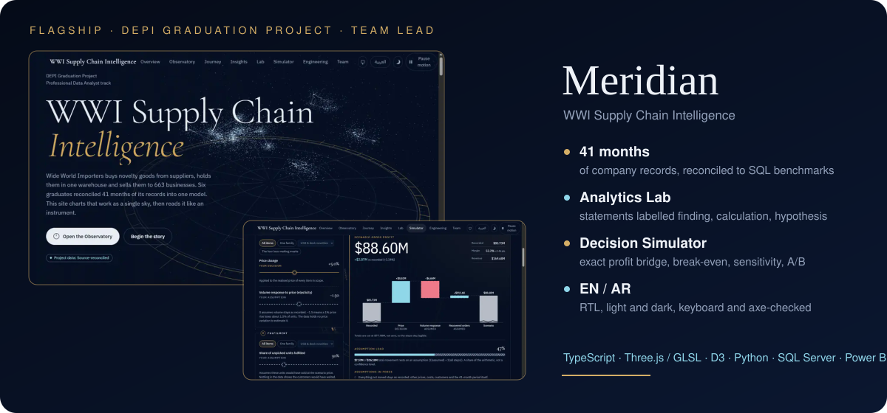
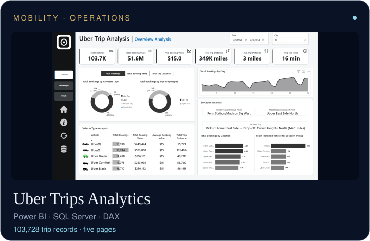
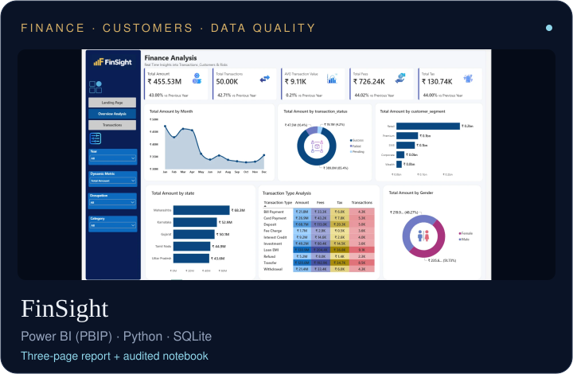
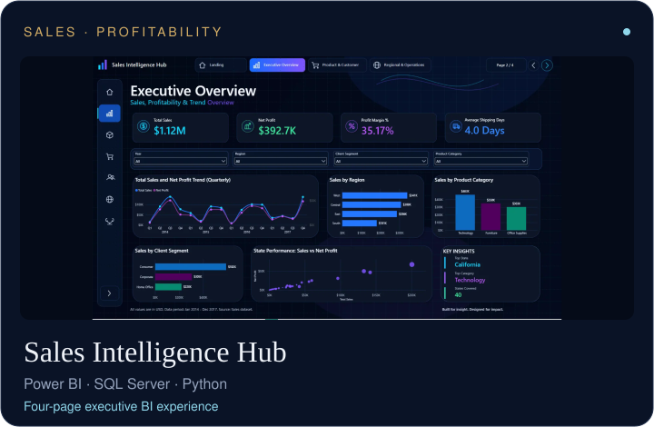
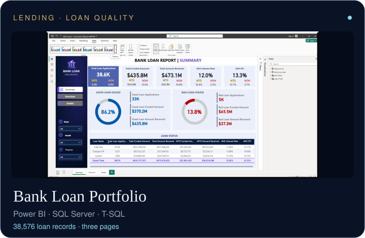
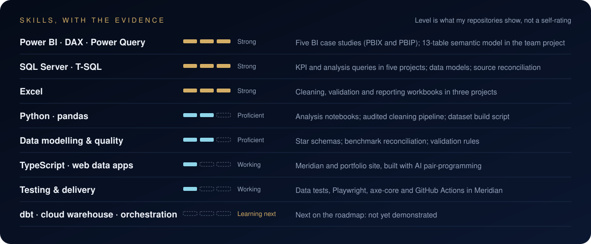
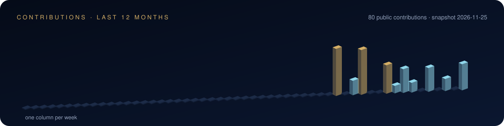

<picture>
  <source media="(prefers-color-scheme: light)" srcset="assets/meridian/hero-light.svg" />
  
</picture>

  <a href="https://omarrez2.github.io/meridian-intelligence/"><strong>Meridian (live)</strong></a> ·
  <a href="https://omarrez2.github.io/"><strong>Portfolio</strong></a> ·
  <a href="https://www.linkedin.com/in/omar-rezk-70868b211/">LinkedIn</a> ·
  <a href="https://www.kaggle.com/omarrezk">Kaggle</a> ·
  <a href="https://omarrez2.github.io/documents/Omar-Mahmoud-Sophy-Rezk-CV.pdf">CV</a> ·
  <a href="mailto:orezk337@gmail.com">Email</a>

I'm a **Data Analyst and BI Developer in Cairo**. I take messy operational data (sales, finance, operations, marketing), model it in **SQL Server** and **Power BI**, and check every figure against its source. Then I present the result in a way a decision-maker can act on. Lately I have been building analytics *products*: interactive tools that explain their own assumptions.

- **Now:** Marketing Data Analyst at Al Farouk Educational Services, and Data Analysis Instructor at eYouth.
- **Graduation project:** team lead of the DEPI WWI Supply Chain Intelligence project (six members).
- **Learning next:** dbt, a cloud warehouse, and orchestration, to grow from analyst toward analytics engineering.

<picture>
  <source media="(prefers-color-scheme: light)" srcset="assets/meridian/divider-light.svg" />
  
</picture>

## Flagship: Meridian

<a href="https://omarrez2.github.io/meridian-intelligence/">
<picture>
  <source media="(prefers-color-scheme: light)" srcset="assets/meridian/meridian-light.svg" />
  
</picture>
</a>

**The business problem.** A wholesaler's sales, purchasing and inventory records didn't agree. Meridian reconciles 41 months of Wide World Importers data, with 663 customers and 227 stock items, into one model. Its totals match the team's SQL benchmarks exactly. It then lets a manager explore the data:

- **Analytics Lab.** Every statement is labelled *finding*, *calculation*, *hypothesis* or *recommendation*, and recomputed from the data at render time.
- **Decision Simulator.** Price, volume, supplier-shock and stock-cover scenarios. Each one shows a profit bridge whose steps add up exactly, a break-even point, sensitivity, and an A/B comparison. Results are presented as scenario arithmetic, not forecasts.
- **Built for real use.** English and Arabic (RTL), light and dark themes, keyboard support, zero axe-core violations, 81 automated data tests, and performance budgets.

[Live site](https://omarrez2.github.io/meridian-intelligence/) · [Decision Simulator](https://omarrez2.github.io/meridian-intelligence/#/simulator) · [Presentation Mode](https://omarrez2.github.io/meridian-intelligence/#/present) · [Source](https://github.com/OmarRez2/meridian-intelligence)
TypeScript · Three.js/GLSL · D3 · Python · SQL Server · Power BI · GitHub Actions

<picture>
  <source media="(prefers-color-scheme: light)" srcset="assets/meridian/pipeline-light.svg" />
  
</picture>

## BI case studies

<table>
<tr>
<td width="50%" valign="top">
<a href="https://omarrez2.github.io/projects/uber-trips-analytics/"><picture><source media="(prefers-color-scheme: light)" srcset="assets/meridian/case-uber-light.svg" /></picture></a>
<b>Uber Trips Analytics</b>: demand, booking value, vehicle and location patterns, with a reusable SQL Server model. 
<a href="https://omarrez2.github.io/projects/uber-trips-analytics/">Case study</a> · <a href="https://github.com/OmarRez2/Uber">Code</a>
</td>
<td width="50%" valign="top">
<a href="https://omarrez2.github.io/projects/finsight-finance-analysis/"><picture><source media="(prefers-color-scheme: light)" srcset="assets/meridian/case-finsight-light.svg" /></picture></a>
<b>FinSight</b>: transactions, customer segments and payment status. The Python notebook audits the data and documents how its figures differ from the report's. 
<a href="https://omarrez2.github.io/projects/finsight-finance-analysis/">Case study</a> · <a href="https://github.com/OmarRez2/Power-BI-Finance-Analysis">Code</a>
</td>
</tr>
<tr>
<td width="50%" valign="top">
<a href="https://omarrez2.github.io/projects/sales-intelligence-hub/"><picture><source media="(prefers-color-scheme: light)" srcset="assets/meridian/case-sales-light.svg" /></picture></a>
<b>Sales Intelligence Hub</b>: sales, profitability, customers and regions, built with Python, SQL, Excel and Power BI. 
<a href="https://omarrez2.github.io/projects/sales-intelligence-hub/">Case study</a> · <a href="https://github.com/OmarRez2/Sales-Intelligence-Hub">Code</a>
</td>
<td width="50%" valign="top">
<a href="https://omarrez2.github.io/projects/bank-loan-analysis/"><picture><source media="(prefers-color-scheme: light)" srcset="assets/meridian/case-bank-loan-light.svg" /></picture></a>
<b>Bank Loan Portfolio</b>: applications, funding, repayments and loan quality, backed by T-SQL KPI and period-comparison queries. 
<a href="https://omarrez2.github.io/projects/bank-loan-analysis/">Case study</a> · <a href="https://github.com/OmarRez2/Bank-Loan">Code</a>
</td>
</tr>
</table>

Also: **[Pizza Sales Performance](https://omarrez2.github.io/projects/pizza-sales-performance/)** covers 48,620 transaction lines in Power BI and SQL ([code](https://github.com/OmarRez2/Pizza-Sales-Project)). Dashboard figures describe each project's dataset, not claimed business impact.

## Skills, with the evidence

<picture>
  <source media="(prefers-color-scheme: light)" srcset="assets/meridian/skills-light.svg" />
  
</picture>

<b>Text version</b>

| Skill | Level | Where it shows |
|---|---|---|
| Power BI · DAX · Power Query | Strong | Five BI case studies (PBIX and PBIP); 13-table semantic model in the team project |
| SQL Server · T-SQL | Strong | KPI and analysis queries in five projects; data models; source reconciliation |
| Excel | Strong | Cleaning, validation and reporting workbooks in three projects |
| Python · pandas | Proficient | Analysis notebooks; audited cleaning pipeline; dataset build script |
| Data modelling & quality | Proficient | Star schemas; benchmark reconciliation; validation rules |
| TypeScript · web data apps | Working | Meridian and portfolio site, built with AI pair-programming |
| Testing & delivery | Working | Data tests, Playwright, axe-core and GitHub Actions in Meridian |
| dbt · cloud warehouse · orchestration | Learning next | Not yet demonstrated |

<picture>
  <source media="(prefers-color-scheme: light)" srcset="assets/meridian/activity-light.svg" />
  
</picture>

## Experience

**Marketing Data Analyst · [Al Farouk Educational Services](https://www.linkedin.com/company/al-faroukedu/)** · September 2026–present
Analyse course-launch campaigns, track CTR and related KPIs, prepare marketing data, and use statistical analysis to give the marketing team recommendations.

**Data Analysis Instructor · eYouth** · April 2026–present
Teach data cleaning, exploratory analysis, SQL, Power BI, KPI reporting and dashboard development.

<b>Earlier experience and education</b>

- **Programming Instructor · Almentor** · October 2023–August 2025: Python, data science and AI fundamentals through the DECI Initiative.
- **AI Model Trainer · Alignerr and Outlier** · 2023–2026: evaluating accuracy, reasoning and instruction following; structured quality feedback.
- **B.Sc. in Computers and Artificial Intelligence** · Benha University.
- **DEPI Graduation Project:** Professional Data Analyst track, as team lead. [Certificates](https://omarrez2.github.io/certificates/)

<picture>
  <source media="(prefers-color-scheme: light)" srcset="assets/meridian/footer-light.svg" />
  
</picture>

Profile art is generated by <code>scripts/generate-meridian-profile.mjs</code>: self-contained SVGs with dark and light variants, whose motion stops under reduced-motion settings.
