  
  

  
  
  
  

  <a href="#-a-little-about-me">About</a> ·
  <a href="#-my-toolbox">Toolbox</a> ·
  <a href="#-project-gallery">Projects</a> ·
  <a href="#-where-i-work">Experience</a>

## 🧑‍💻 A little about me

I'm **Omar Rezk**, a Data Analyst and BI Developer based in **Cairo, Egypt**. I enjoy finding the story behind the numbers—and making it useful.

- 💼 **Marketing Data Analyst @ Al Farouk Educational Services**
- 🎓 **Data Analysis Instructor @ eYouth**
- 📊 I work with **Power BI, SQL, Python and Excel**.
- 🔎 My focus: campaign performance, reliable reporting, and clear business insights.
- 💬 I enjoy turning complex concepts into practical learning experiences.

**[Get to know me ↗](https://omarrez2.github.io/about/)** · **[View my CV ↗](https://omarrez2.github.io/documents/Omar-Mahmoud-Sophy-Rezk-CV.pdf)**

 

## 🚀 My toolbox

  <strong>Power BI · SQL Server · Python · Excel · DAX · Power Query · Pandas · Git</strong> 
  Data cleaning & validation · Statistical analysis · Data modeling · KPI reporting 
  Marketing analytics · Dashboard design · PBIP / TMDL · Data storytelling

## ✨ Project gallery

<strong>From raw data to a business story.</strong> Select a project to explore the full case study, dashboards and code.

<table>
<tr>
<td width="50%" valign="top">

<h3>FinSight · Finance Analysis</h3>

Transaction activity, customer segments and payment statuses across a three-page Power BI report.

<strong>Power BI · Python · SQLite</strong>

<a href="https://omarrez2.github.io/projects/finsight-finance-analysis/"><strong>Case study ↗</strong></a> &nbsp; · &nbsp; <a href="https://github.com/OmarRez2/Power-BI-Finance-Analysis">Code ↗</a>

</td>
<td width="50%" valign="top">

<h3>Sales Intelligence Hub</h3>

Sales, profitability, customers, products and regional performance in a four-page BI experience.

<strong>Power BI · SQL Server · Python</strong>

<a href="https://omarrez2.github.io/projects/sales-intelligence-hub/"><strong>Case study ↗</strong></a> &nbsp; · &nbsp; <a href="https://github.com/OmarRez2/Sales-Intelligence-Hub">Code ↗</a>

</td>
</tr>
<tr>
<td width="50%" valign="top">

<h3>Uber Trips Analytics</h3>

Explore trip demand, booking value, locations and time patterns through five report pages.

<strong>Power BI · SQL Server · DAX</strong>

<a href="https://omarrez2.github.io/projects/uber-trips-analytics/"><strong>Case study ↗</strong></a> &nbsp; · &nbsp; <a href="https://github.com/OmarRez2/Uber">Code ↗</a>

</td>
<td width="50%" valign="top">

<h3>Bank Loan Portfolio</h3>

A three-page view of applications, funding, repayments, loan quality and borrower characteristics.

<strong>Power BI · SQL Server · T-SQL</strong>

<a href="https://omarrez2.github.io/projects/bank-loan-analysis/"><strong>Case study ↗</strong></a> &nbsp; · &nbsp; <a href="https://github.com/OmarRez2/Bank-Loan">Code ↗</a>

</td>
</tr>
</table>

<strong>🔍 More projects & data notes</strong>

**Pizza Sales Performance:** product mix, demand patterns and peak sales periods. [Case study](https://omarrez2.github.io/projects/pizza-sales-performance/) · [Code](https://github.com/OmarRez2/Pizza-Sales-Project)

**FinSight data context:** the notebook covers January 2023–April 2026. Power BI uses absolute transaction amounts and imputed missing fees; the notebook preserves signed amounts and unknown fees, so totals differ. Transaction volume is not bank revenue.

Dashboard figures describe their project datasets, not claimed business impact.

## 💼 Where I work

### Marketing Data Analyst · [Al Farouk Educational Services](https://www.linkedin.com/company/al-faroukedu/)
**September 2026 — Present**

Analyze educational course-launch campaigns, track **CTR and related KPIs**, query and prepare marketing data, and use **statistical analysis** to develop insights and recommendations for the marketing team.

### Data Analysis Instructor · eYouth
**April 2026 — Present**

Teach practical data cleaning, exploratory analysis, SQL, Power BI, KPI reporting and dashboard development.

<strong>🎓 Earlier experience & education</strong>

- **Programming Instructor · Almentor · October 2023–August 2025:** Python, data science, AI fundamentals and analytical problem-solving through the DECI Initiative.
- **AI Model Trainer · Alignerr · 2023–2026:** evaluate accuracy, reasoning, instruction following and consistency.
- **AI Model Trainer · Outlier · 2023–2026:** prompt testing, response comparison and structured quality feedback.
- **B.Sc. in Computers and Artificial Intelligence · Benha University.**

[Explore my certificates ↗](https://omarrez2.github.io/certificates/)

## 🤝 Let's connect

Have a data question, a Power BI project, or a role in mind? 
<strong>I'd love to hear about it.</strong>

<a href="mailto:orezk337@gmail.com">orezk337@gmail.com</a>

