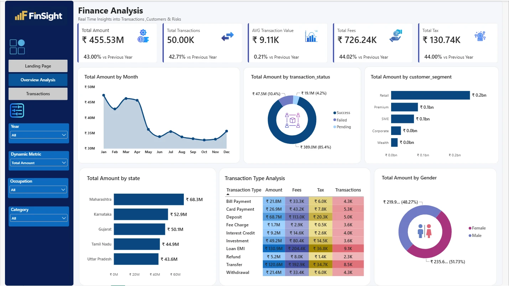
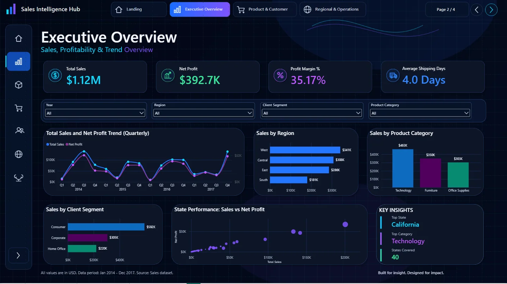
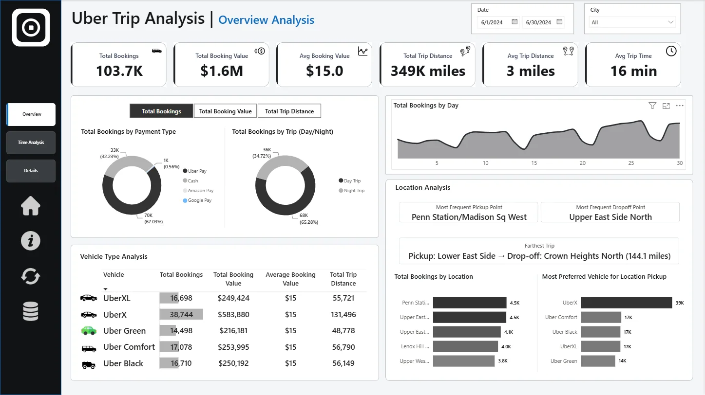
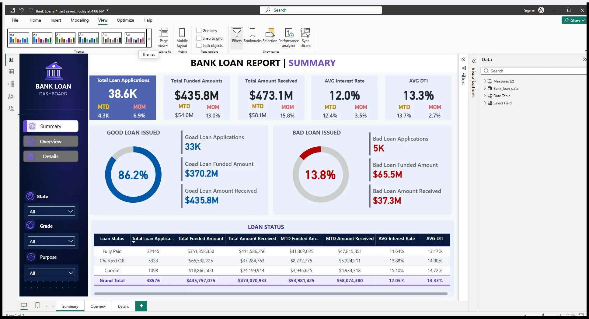
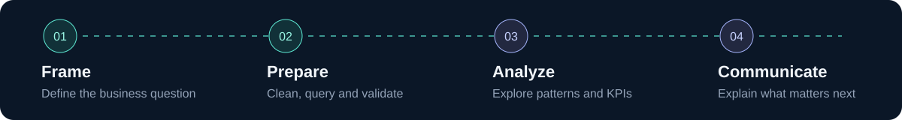

  

  <a href="https://omarrez2.github.io/"><strong>EXPLORE MY PORTFOLIO ↗</strong></a> &nbsp; · &nbsp;
  <a href="#selected-projects">Projects</a> &nbsp; · &nbsp;
  <a href="#experience">Experience</a> &nbsp; · &nbsp;
  <a href="#lets-connect">Contact</a>

# Hi, I'm Omar.

**Marketing Data Analyst at [Al Farouk Educational Services](https://www.linkedin.com/company/al-faroukedu/) · Power BI & SQL · Cairo, Egypt**

I turn business questions into structured analysis, interactive dashboards, and practical recommendations. My work connects data preparation, SQL exploration, statistical analysis, and Power BI reporting—with the business decision always in view.

At **Al Farouk**, I analyze marketing performance for educational course launches: track CTR and related campaign KPIs, query and prepare the data, and translate findings into insights for the marketing team.

[LinkedIn ↗](https://www.linkedin.com/in/omar-rezk-70868b211/) &nbsp; / &nbsp; [Kaggle ↗](https://www.kaggle.com/omarrezk) &nbsp; / &nbsp; [Email me ↗](mailto:orezk337@gmail.com) &nbsp; / &nbsp; [View CV ↗](https://omarrez2.github.io/documents/Omar-Mahmoud-Sophy-Rezk-CV.pdf)

## Selected projects

Real dashboard previews. Clear analytical questions. Code and case studies you can explore.

### 01 / FinSight — Finance Analysis

**How do transaction activity, customer segments, and payment statuses vary?**

Three Power BI pages connect the overview to transaction detail. A separate Jupyter cleaning workflow and SQLite KPI views document the underlying analysis.

`Power BI` `DAX` `Power Query` `Python` `SQLite`

**[Read the case study ↗](https://omarrez2.github.io/projects/finsight-finance-analysis/)** &nbsp; · &nbsp; [Explore repository](https://github.com/OmarRez2/Power-BI-Finance-Analysis)

Data context and interpretation

The notebook-cleaned dataset covers January 2023–April 2026. The dashboard uses a separate Power Query cleaning policy: absolute amounts and imputed missing fees. The notebook preserves signed amounts and unknown fees, so totals differ. Transaction volume is not bank revenue.

---

### 02 / Sales Intelligence Hub

**Where are sales and profit coming from—and how do products and regions compare?**

A four-page Power BI experience covering commercial performance, customers, products, regions, and fulfillment. Python and SQL support the preparation and analytical workflow.

`Power BI` `DAX` `SQL Server` `Python` `PBIP / TMDL`

**[Read the case study ↗](https://omarrez2.github.io/projects/sales-intelligence-hub/)** &nbsp; · &nbsp; [Explore repository](https://github.com/OmarRez2/Sales-Intelligence-Hub)

---

### 03 / Uber Trips Analytics

**When and where does trip demand concentrate?**

A five-page Power BI and SQL analysis of demand, booking value, vehicles, routes, time patterns, and trip quality.

`Power BI` `DAX` `SQL Server` `Python`

**[Read the case study ↗](https://omarrez2.github.io/projects/uber-trips-analytics/)** &nbsp; · &nbsp; [Explore repository](https://github.com/OmarRez2/Uber)

---

### 04 / Bank Loan Portfolio Analysis

**What do applications, repayments, and loan status reveal about the portfolio?**

A three-page lending portfolio report exploring funding, repayments, borrower characteristics, and loan quality.

`Power BI` `DAX` `SQL Server` `T-SQL`

**[Read the case study ↗](https://omarrez2.github.io/projects/bank-loan-analysis/)** &nbsp; · &nbsp; [Explore repository](https://github.com/OmarRez2/Bank-Loan)

<strong>More work / Pizza Sales Performance</strong>

Sales analysis covering product mix, demand patterns, peak periods, and best- and worst-selling products.

[Repository](https://github.com/OmarRez2/Pizza-Sales-Project) · [Case study](https://omarrez2.github.io/projects/pizza-sales-performance/)

## How I work

**Question → Prepare → Analyze → Communicate**

Start with the decision. Check the data. Explore the patterns. Make the result understandable.

| Focus | Tools and methods |
| :--- | :--- |
| Business intelligence | Power BI, DAX, Power Query, data modeling, PBIP / TMDL |
| Data and analysis | SQL Server, Python, Pandas, Excel, statistical analysis |
| Marketing analytics | CTR and campaign KPI tracking, course-launch performance, insight reporting |
| Delivery | Data validation, dashboard design, analytical storytelling, Git |

## Experience

### Marketing Data Analyst · Al Farouk Educational Services
**September 2026 — Present** · [Company](https://www.linkedin.com/company/al-faroukedu/)

- Analyze marketing performance for educational course launches.
- Track CTR and related campaign KPIs, and query and prepare marketing data.
- Apply statistical analysis and communicate insights and recommendations to the marketing team.

### Data Analysis Instructor · eYouth
**April 2026 — Present**

Practical training in data cleaning, exploratory analysis, SQL, Power BI, KPI reporting, and dashboard development.

Earlier experience and education

- **Programming Instructor · Almentor · October 2023–August 2025:** Python, data science, AI fundamentals, and analytical problem-solving through the DECI Initiative.
- **AI Model Trainer · Alignerr · 2023–2026:** Evaluation of model outputs for accuracy, reasoning, instruction following, and consistency.
- **AI Model Trainer · Outlier · 2023–2026:** Prompt testing, response comparison, and structured quality feedback.
- **B.Sc. in Computers and Artificial Intelligence · Benha University.**

[More about my background](https://omarrez2.github.io/about/) · [Certificates](https://omarrez2.github.io/certificates/)

## Let's connect

Have a reporting challenge, a Power BI project, or a data role in mind? I'd be happy to talk.

**[Visit my portfolio ↗](https://omarrez2.github.io/)** &nbsp; · &nbsp;
[LinkedIn](https://www.linkedin.com/in/omar-rezk-70868b211/) &nbsp; · &nbsp;
[orezk337@gmail.com](mailto:orezk337@gmail.com)

Project dashboards describe their datasets, not claimed business results. Animated artwork is decorative; all essential information is available as text.
